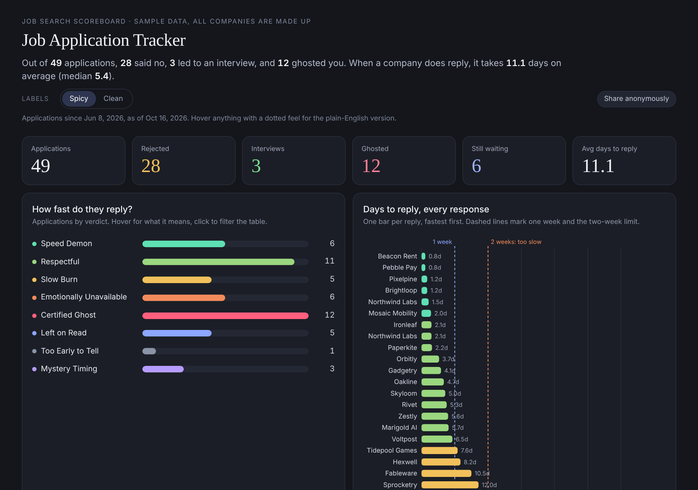

# Job App Ghost Tracker

Want to see the data on how many companies have replied to your job app with an interview, auto-rejected, or straight-up ghosted you? Introducing... **A Certified Ghost detector for your job search.** This is a Claude (or any AI assistant) skill that reads your email, scores every company on how fast it replied, and displays a gorgeous dashboard (dark or light, your pick) of the evidence. If you opt in, your results join an anonymous pool, so we can eventually publish how long companies really take to reply, and which ones go silent. Let's make ghosting visible.



*Sample data. Every company shown is made up, though you will recognize the behavior.*

## What it does

- Scans your email inbox & counts your applications, rejections, interviews, and the silence that hits harder than any dating app.
- Measures days to reply, per company.
- Hands out verdicts, from **Speed Demon** to **Certified Ghost**. Two weeks counts as slow, because it is.
- You can change the verdict titles by telling it so
- Optional feature to send the data results of the companies and how long they took to respond to a Job App Ghost Tracker database for future public visibility of estimated company average response times.

It only reads your email. It never sends, deletes, or changes anything.

## Install it

**Claude Skill on the web or desktop (zip, about 3 minutes):**

1. Download [`job-app-ghost-tracker.zip`](job-app-ghost-tracker.zip) from this repo. Do not unzip it.
2. In Claude, open [**Customize > Skills**](https://claude.ai/customize/skills) and upload the zip. Turn the skill on.
3. Connect your email to Claude. Gmail is the tested one.

**Then ask:** *"How many companies ghosted me this year?"* You do not need to say the skill's name. It asks which time range to scan (1 month, 6 months, 1 year, or your own dates) and the first time, dark or light.

**Updating:** reinstall the same way. On the web or desktop, delete the old skill first, then upload the new zip.

**Claude Code (two commands):**

```
/plugin marketplace add KaoNotCow/job-application-ghosting-tracker
/plugin install job-app-ghost-tracker@kaosmith
```

Run them one at a time. On Claude Code 2.1.275 or newer, one command also works: `/plugin install job-app-ghost-tracker --marketplace KaoNotCow/job-application-ghosting-tracker`. On older versions that form just opens the plugin browser, which will not list this plugin.


## Other AI Assistants or Claude Free Plan

The instructions are plain English. At the moment, this has been untested, so expect some assembly.

1. Paste [`SKILL.md`](skills/job-app-ghost-tracker/SKILL.md) into your assistant and say: "Follow this. Here are my job application emails." If it cannot read your inbox, export or paste the emails yourself.
2. Ask it to put the results into the JSON block of [`dashboard-template.html`](skills/job-app-ghost-tracker/dashboard-template.html).
3. Open that file in any browser. The dashboard needs no AI, only a browser.

## What the verdicts mean

| Verdict | Plain English |
|---|---|
| Speed Demon | Replied within 2 days |
| Respectful | Within a week |
| Slow Burn | 1 to 2 weeks |
| Emotionally Unavailable | More than 2 weeks |
| Certified Ghost | 3+ weeks of nothing |
| Left on Read | No reply yet, still waiting |
| Too Early to Tell | Applied under a week ago |

Need it boring? Say "use clean labels" (Fast, Slow, No response) or flip the toggle in the dashboard.

## Email support

| Inbox | Status |
|---|---|
| Gmail | Tested |
| Outlook / Microsoft 365 | Should work through Claude's connector. Untested. |
| Yahoo and others | Forward job mail to Gmail, or export a mailbox file. Untested. |

## Privacy

It runs in your own session, so your data goes nowhere. The dashboard has an optional, preview-first button, **Opt-In to Share Company Response Data with Job GhostTracker**, that sends only company, outcome, days to reply and month applied. Nothing is sent unless you confirm. Inside Claude's viewer the send may be blocked, so the dashboard lets you save a file and send from your browser. Full details in [PRIVACY.md](PRIVACY.md).

## For tinkerers

- **How it works:** three email searches (confirmations, rejections, interviews), rule-based classification for the common job-board templates, and all math done in code. A small `job-tracker.csv` remembers the scanned range, so reruns only read the gaps (older mail you newly asked for, and mail since the last scan).
- **Scoring:** speed score is `100 - 5 * (days - 1)`, floored at 0. Interviews add 15. Ghosted means no reply after 21 days.
- **Dashboard data:** one JSON block. Example row: `{"id":"a1","company":"Example Co","role":"Senior PM","applied_at":"2026-09-01T16:00:00Z","replied_at":"2026-09-03T10:00:00Z","status":"Rejected","as_of":"2026-10-16T18:56:00Z","engaged":false}`. See [`examples/`](examples/) for 49 fake ones.
- **Stats collector:** [`collector/`](collector/SETUP.md) is a Cloudflare Worker plus D1 database on the free plan, with strict validation and no IP storage.
- **Limits:** email only, so portal-only updates are invisible. Classification is judgment, so check the caveats it lists. A dashboard is a snapshot, not a live feed.

Issues and ideas welcome, especially new job-board templates and better insults.

---

Made by [Kao Smith](https://kaosmith.com) · MIT license
